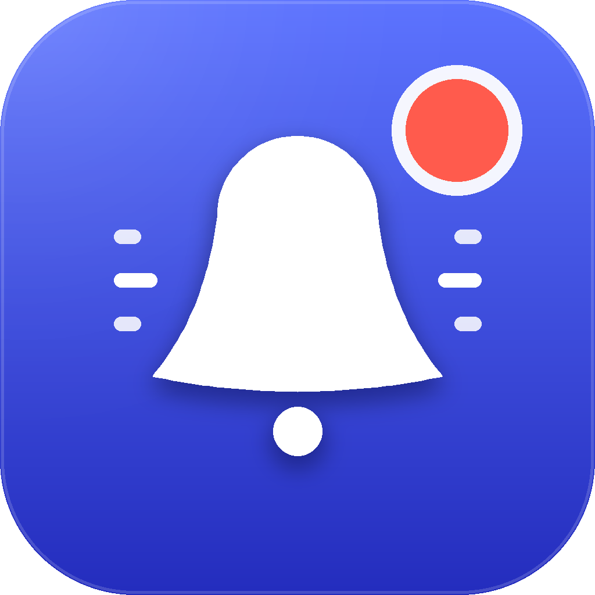

# dsh-dock-attention

[](LICENSE)
[](#limitations)
[](https://deepseek-harness.github.io/deepseek-harness/en/develop/basic/)
[](https://github.com/ihodorchenko/dsh-dock-attention/releases)

A Host plugin for **DeepSeek Harness** that bounces a Dock icon when the agent needs
you and the Harness window is not frontmost.



The plugin watches the durable session event feed — approvals, agent questions and
finished turns — and only then reaches for the Dock. If you are already looking at
Harness, nothing happens: attention is for when you are away, not for interrupting
the window you are in.

## Why a separate beacon in the Dock

The Dock tile of the Desktop app belongs to its Electron main process, and
`app.dock.bounce()` is a main-process API. A Host plugin runs in a separate Node
child process (the private Desktop Host) and cannot call it; the Dock additionally
refuses cross-process "bounce another app's tile" requests unless the caller carries
a private entitlement. That makes "make the DSH icon bounce" impossible for a plain
plugin, no matter which hook it uses.

So this plugin ships the smallest honest alternative: a native helper app,
**DSH Attention**. When attention is needed, the Host plugin writes a request file,
launches the helper in the background (`open -n -g`), and the helper:

1. starts as a background agent, so it never steals focus;
2. promotes itself to a regular app, which gives it a Dock tile;
3. asks AppKit for user attention, so that tile bounces;
4. quits — and takes its tile with it — as soon as the Harness window comes to the
   front, its own icon is clicked, or the time budget runs out.

Clicking the bouncing tile activates Harness (or launches it, when it is not
running). The helper needs **no** Accessibility, Automation, Screen Recording or
Notification permissions: focus detection uses `NSWorkspace` through JXA, and the
bounce is AppKit's own `requestUserAttention`.

## What triggers it

| Moment | Event | Default |
|---|---|---|
| The agent waits for an approval decision | `approval/asked` | on |
| The agent asks a question (`ask_user_question`, `exit_plan_mode`) | `tool/call` | on |
| A turn finished, failed, was blocked, or hit the token limit | `turn/end` | on |

Silent cases: turns the user cancelled (`aborted`), forked or interrupted turns, and
subagent sessions (unless `includeSubagents: true`). A bounce is also skipped when
one of `activeBundleIds` is frontmost, when a beacon is already bouncing, or when
the event arrives within `minIntervalSeconds` of the previous one.

## Install

**Plugin Manager / CLI:**

```sh
dsh plugin --profile desktop add "github:ihodorchenko/dsh-dock-attention"
```

Plugin Manager also accepts the git URL
`git+https://github.com/ihodorchenko/dsh-dock-attention.git`. A source archive is
attached to every [release](https://github.com/ihodorchenko/dsh-dock-attention/releases).

**From a local checkout:**

```sh
dsh plugin --profile desktop add "link:/absolute/path/to/dsh-dock-attention"
```

**Without Plugin Manager** — point a profile patch row at the package directly
(the Loader watches the profile, so a new row appears without a restart):

```yaml
- insert:
    - id: dock-attention
      name: 'file:///absolute/path/to/dsh-dock-attention/index.js'
      config:
        mode: critical
```

The plugin only runs on macOS. On other platforms it mounts and does nothing.

## Configuration

Every field is optional; the row's `config` mapping is merged over these defaults.

| Field | Default | Meaning |
|---|---|---|
| `enabled` | `true` | Master switch. |
| `targetBundleId` | `com.deepseek.dsh` | App the beacon activates and watches. Point it at your browser bundle id when you run `dsh web` in a browser. |
| `activeBundleIds` | `['com.deepseek.dsh']` | Foreground apps that count as "already looking at Harness". |
| `skipWhenActive` | `true` | Never bounce while one of `activeBundleIds` is frontmost. |
| `bounceOnApproval` | `true` | Bounce when an approval is requested. |
| `bounceOnQuestion` | `true` | Bounce when the agent asks a question. |
| `bounceOnTurnEnd` | `true` | Bounce when a turn ends (finished, failed, blocked, token limit). |
| `includeSubagents` | `false` | Also bounce for subagent sessions. |
| `mode` | `critical` | `critical` bounces until you come back (or the timeout); `informational` bounces `repeatCount` times. |
| `repeatCount` | `3` | Number of single bounces in `informational` mode (1–20). |
| `timeoutSeconds` | `30` | How long the beacon tile may stay in the Dock (3–300). |
| `minIntervalSeconds` | `3` | Debounce window between two bounces (0–120). |
| `sound` | `null` | macOS system sound name (`Glass`, `Ping`, …) or an absolute audio path; `null` is silent. |
| `openUrl` | `dsh://open` | Fallback opened by the beacon when `targetBundleId` is not installed. |

```yaml
- id: dock-attention
  name: dsh-dock-attention
  config:
    mode: critical
    timeoutSeconds: 45
    bounceOnTurnEnd: false   # only "needs you" moments
    sound: Glass
```

Running `dsh web` in Safari? Use:

```yaml
config:
  targetBundleId: com.apple.Safari
  activeBundleIds: ['com.apple.Safari']
```

## Verifying it works

```sh
node tools/self-check.mjs
```

The self-check compiles nothing; it launches the bundled beacon, watches it through
`NSWorkspace`, waits for it to exit, and prints the helper log tail. Watch the Dock
while it runs: a bouncing **DSH Attention** icon should appear and disappear after
about eight seconds.

## Limitations

- **macOS only.** The whole mechanism is macOS-specific.
- **The beacon is a separate Dock icon**, not the Harness icon itself (see
  "Why a separate beacon" above). It exists in the Dock only while attention is
  pending; clicking it returns to Harness.
- **While the beacon is active it is a regular app**, so it is visible in the Dock
  and can appear in Cmd-Tab for those few seconds. It never takes focus on launch.
- **No notification and no sound by default** — those are separate plugins. Set
  `sound` or pair it with `dsh-macos-notifications` if you want more than motion.
- macOS "Reduce motion" and third-party Dock-animation tweaks can suppress the
  bounce animation; the plugin cannot detect that. The tile still appears.
- macOS throttles very long `critical` requests; lower `timeoutSeconds` (10–15 s) if
  you want a shorter, unthrottled burst.
- The helper is ad-hoc signed, not notarized. A plugin installed from a local
  checkout or a `git` dependency is not quarantined and launches fine; if a zip
  download did add the quarantine attribute, run
  `xattr -dr com.apple.quarantine "bin/DSH Attention.app"` once.
- If the Harness window is in the foreground, by design nothing bounces.

## Troubleshooting

- **No icon appears at all** — run `node tools/self-check.mjs`; it reports whether the
  helper launched at all and prints the tail of `runtime/helper.log`.
- **Icon appears but never bounces** — check "Reduce motion" in System Settings →
  Accessibility, and Dock animation tweaks. The beacon log still shows
  `requestUserAttention(...) -> id=0`, which means the request was accepted
  (return value `0` is a valid first request id — `-1` would mean the app was active).
- **The beacon appears while you are already looking at Harness** — set
  `skipWhenActive: true` (the default) and make sure `activeBundleIds` names the
  right app; browser users must add their browser's bundle id.

## Files

| File | Role |
|---|---|
| `index.js` | Host plugin: session-event listeners and attention dispatch |
| `lib/attention.js` | Config normalization, event mapping, focus probe, beacon launch |
| `bin/DSH Attention.app` | Native beacon app (universal binary, ad-hoc signed) |
| `src/helper/main.swift` | Beacon source; `tools/build-helper.sh` rebuilds the bundle |
| `runtime/request.json`, `runtime/helper.log` | Written at run time; git-ignored |
| `cordis.patch.yml` | Bundle patch that inserts the `dock-attention` row |
| `locale/en.json`, `locale/ru.json` | Plugin Manager display metadata |
| `icon.svg`, `docs/icon-1024.png` | Plugin icon and app icon source |

## Development

```sh
node --test                        # 18 unit tests (config, event mapping, wiring)
bash tools/build-helper.sh         # rebuild bin/DSH Attention.app (needs Xcode CLT)
python3 tools/render-icon.py       # optional: re-render AppIcon.icns (needs Pillow)
```

The helper source is small enough to audit: `requestAttention`, the single-instance
guard, the frontmost-app poll, and the click/activation forwarding are all in
`src/helper/main.swift`.

## License

MIT — see [LICENSE](LICENSE). The beacon is ad-hoc signed (no Apple Developer
identity), so it carries no notarization; it is launched from a local package
directory and needs no quarantine escape hatch.
